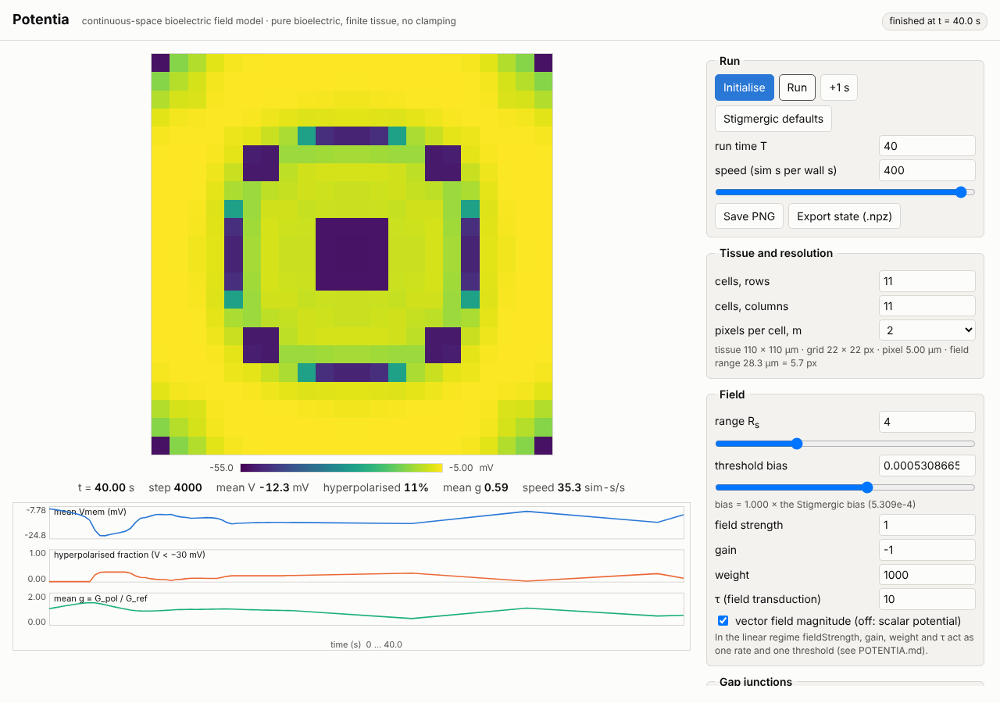
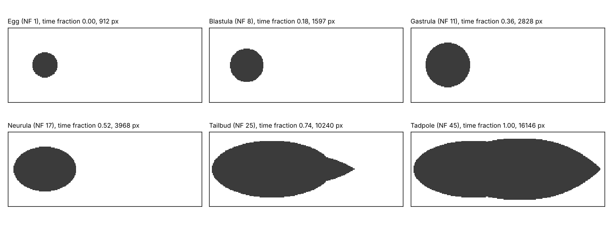

# Potentia: a continuous-space generalisation of the bioelectric field model

Potentia does for the cellular field network what Lenia does for the Game of Life: the states were
already continuous (Vmem, G_pol), so the generalisation makes **space** continuous.

Scope of this first version (all deliberate):

* pure bioelectric: **no GRN is loaded** (`geneRegulatoryNetwork` is never imported); the original's GRN
  provision is kept as an inert hook (`grn=None`); no ligand either (disabled in the Stigmergic file)
* **finite tissue** by default (no-flux gap-junction edges; the field comes only from charge inside the tissue). A periodic (torus) boundary is available as an option (`periodic=True`; a checkbox in the visualizer, section 9); all sweeps and the atlas use the finite rectangle. The tissue can also be given a **shape** (`Potentia(mask=...)`, `shapes.py`; disc, ring, capsule, hexagon, tadpole, a hand-drawn mask, ...; section 9): outside the shape there is no tissue, and its boundary is a no-flux edge. A **development** option morphs the shape over time through a schematic frog sequence (`development.py`, section 9); the morphology is prescribed, not an outcome of the bioelectric dynamics
* **endogenous** patterning from a **homogeneous start** (Vmem = -9.2 mV, G_pol = 1.0 G_ref, eV = 0); **no clamping** in the model and the sweeps (the visualizer can optionally hold painted pixels for a number of steps, an experiment tool described in section 9)

Everything here is numpy/scipy; torch is not needed (`torchfree_io.py` reads the repo's `.dat` files).

## 1. Model

State: `V(x,t)` (membrane potential) and `g(x,t) = G_pol/G_ref`, on a pixel grid of pitch `h = p/m`.
Lengths: `a` = cell radius (5 um), `p = 2a` = cell pitch, `R = a*sqrt(2)*(R_s + .001)` = field range.

```
C dV/dt = I_ion(V,g) + div( D * gate(p |dV|/V0) grad V ),        D = G0 p^2 / C,   gate(x) = 2/(1+cosh x)
dg/dt   = (10/tau) * ( -leak*g + w * tanh((gamma*ebar + beta)/2) ),     g in [0, 2]
E(x)    = fc * (C/p^2) * INT V(y) K(x-y) d2y,     K(r) = r/|r|^2 for |r| <= R       (screened 2D Coulomb)
ebar(x) = mean over s in {+-1}^2 of |E(x + a s)|                                       (perception at cell corners)
```

| lattice model | Potentia |
|---|---|
| cells on an N x N grid | fields on a pixel grid, `m` pixels per cell pitch (`m=1, source='point'` is the lattice exactly) |
| gap junction G_ij(Vi-Vj) between 4 neighbours | gated nonlinear diffusion; the gate acts on the cell-scale difference `p*grad V` |
| Coulomb sum over cell charges Q = C V | convolution of the charge density `C V / p^2` with the truncated kernel (FFT); source pixel area-integrated |
| cell averages the 4 corner probes | same 4 probes, at the physical offsets `(+-a, +-a)` |
| `latticeDims = (11,11)` | tissue extent: `size_cells=(11,11)` or, in physical units, `size_um=(110,110)` |

**Initial conditions are set on G_pol.** G_pol directly determines Vmem: an isolated cell relaxes to a Vmem fixed by its conductance within about 0.6 to 1.2 s, so an initial Vmem is discarded outside
the bistable window. Measured for the model's channels (`G_dep = 1.5`): g below 0.803 has one stable state, depolarised (-5.0 to -8 mV); between 0.803 and 1.439 there are two (e.g. -9.24 and -49.54 mV at g=1);
above 1.439 one, hyperpolarised (about -52 to -53 mV). `Potentia.initial_from_g(g, branch)` therefore builds the state from a G_pol field and sets each pixel's Vmem to the isolated-cell equilibrium
(`equilibrium_V`); only inside the window a choice remains, the branch (`'dep'`, the repo's default start, or `'hyp'`). The repo's own start (g=1, V=-9.2 mV) is the depolarised branch at g=1 (equilibrium -9.24 mV; the
visualizer's homogeneous start uses -9.24, 0.04 mV away; the sweeps above used -9.2 and were not re-run).
Vmem is not always irrelevant inside the window, but there the field feedback usually overrules it: a -55 mV patch painted over g=1 persists with the field off (-50.6 to -52.7 mV over 3 s) but with the field on
its rim field pulls g down to the window edge (0.83) and the patch collapses to -9 mV between 2 and 3 s.

**What "grid" means here.** Two different things:

1. *Tissue extent* (110 x 110 um). A property of the model: the boundary matters. `size_um` states it in length units.
2. *Pixel grid* (`m`). A numerical device (like Lenia's pixels). The answer should not depend on it, and the lattice is its coarsest setting.

The cell survives only as length scales: `p` in the GJ coupling and gate, `C/p^2` charge density, `a` in the perception offsets, `R` in the field range.
Potentia keeps the lattice's square symmetry (axis-aligned GJ gate, square-corner sensing); it is not isotropic. Measured in section 10: the gated gap-junction term applied to a radially symmetric bump varies by 47-51% around a circle (4th harmonic 12%, not decreasing as `m` grows from 2 to 8), the linear 5-point stencil by 0.3% at `m=2` falling to 0.02% at `m=8`, and the perceived field of a smooth bump by about 0.1%.

## 2. Facts about the original model found along the way (evidence in this directory)

1. **G_pol is a clipped, essentially leak-free integrator.** In the repo `dp = 10*(-G_pol + tanh*w)/tau` with `G_pol` in siemens (~1e-9)
   and `tanh*w` dimensionless, so the effective leak coefficient is 1e-9. Replaying the recorded Stigmergic run with a dimensionally consistent
   leak (`leak=1`) gives loss 4.009 instead of the recorded 2.084 and a 46 mV final-state mismatch (`validate_against_recorded.py`, `LEAK=1`);
   from a homogeneous start the lattice port (11x11) then collapses to a uniform Vmem = -5.7 mV with no pattern. The trained behaviour depends on the integrator.
   Potentia defaults to the as-implemented equation; `leak=1.0` gives the consistent one.
2. **Four of the field parameters are one knob.** At the Stigmergic point the tanh argument never exceeds 5e-4, so the sigmoid is effectively linear.
   `weight=2000` vs `fieldStrength=2, bias=2*bias*` differ by 2.5e-4 mV; vs `gain=-2, bias=2*bias*` by 1e-5 mV; vs `tau=5` by 9e-7 mV
   (while `weight=2000` vs the reference differs by 14.6 mV). The identifiable parameters are range `R_s`, threshold `bias/(|gain| fs)`,
   rate `weight|gain| fs/tau`, and GJ strength. The degeneracy breaks only as `|x|` approaches 1 (17.6 mV at `fs=1000`).
3. **The Stigmergic field parameters were fixed, not learned** (per the authors' clarification): they were chosen to maximise *pattern complexity*, and only the clamp
   protocol was then learned. The repo's complexity measure is TSE complexity (`analyzeSensitivityTSEComplexity.py`, over a 625-point grid of GJ strength, screen size,
   transduction weight and bias). They equal the fixed values in `runLearnCellularFieldNetworkLocal.sh` (`R_s=4, fs=1, weight=1000, gain=-1, GJ=0.05`) and in
   `StigmergicModelParameters.dat`. An earlier version of this note read the bias as learned; that was wrong.
4. *(by reading the code; not executed, torch is unavailable here)* the current `model.py:57` / `cellularFieldNetwork.py:85-93,175-179` appear unable to load
   `StigmergicModelParameters.dat` as-is: its `GRNParameters` has no `GRNEnabled` key (KeyError), and with `GRNEnabled` False the attributes `numGenes`/`GRNTarget` are never set.

## 3. Validation

| check | result |
|---|---|
| Potentia(`m=1`, point source) vs the independent numpy lattice port; finite + periodic, vector + scalar field, homogeneous + random states, non-square domain | max abs difference 4.8e-14 V / 3.6e-13 g (`validate_potentia.py`) |
| the port vs the **recorded** Stigmergic training run (clamped, 1000 it.) | loss 2.084212 vs recorded 2.084209 (rel. 2e-6); final Vmem within 0.0003 mV over 121 cells (`validate_against_recorded.py`). The clamp is replayed only here, as a test. |
| the same check with a consistent leak | fails (loss 4.009, 46 mV): the test discriminates |
| GRN provision | inert by default (no GRN/torch import); bit-identical to no hook when weights and leak are zero; live when given weights (`validate_provision.py`) |
| continuum limit | statistical, **not** pointwise (below) |

"The original" in every comparison is this numpy port, not the torch code itself.

**Continuum limit.** Early (deterministic) dynamics converge; long-time trajectories do not, because the dynamics are chaotic.
On parameter sets that have left the initial state by t = 3 s (63 of 88 in S1): Potentia `m=2` vs `m=4` differ by a median 0.01 mV (0.3% of the departure),
whereas original vs Potentia differ by 0.31 mV (8%, range 2-20% by `R_s`) **independent of `m`** (0.31 at `m=2`, 0.38 at `m=4`):
a systematic lattice-vs-continuum difference, not noise.

**Chaos.** Largest Lyapunov exponent at the Stigmergic point, 11x11, renormalised twin runs (1500 s; the quoted errors are probably underestimates):

| kick | original `m=1` | Potentia `m=2` | Potentia `m=4` |
|---|---|---|---|
| asymmetric (all pixels) /s | +0.054 +- 0.008 | +0.033 +- 0.007 | +0.057 +- 0.009 |
| symmetric (inside the D4 subspace) /s | +0.046 +- 0.010 | +0.021 +- 0.010 | +0.049 +- 0.011 |

Both are chaotic. `m=2` is lower in both rows while `m=1` and `m=4` agree; I could not explain this.

## 4. What patterns appear (Potentia, homogeneous start, finite tissue)

A homogeneous interior has zero field, so `g` integrates upward and the interior hyperpolarises; only the rim senses a field and depolarises.
The rim-core interface (strong field) then sweeps inward as a contracting square front, leaving nested rings; fronts from edges and corners interfere and the
pattern keeps changing. Solutions stay D4-symmetric (square tissue + homogeneous start; checked to within 1e-6 mV over 160 s at `m=2`, 31x31), although the symmetric state is unstable to asymmetric kicks (Lyapunov > 0).

`results/fig_atlas_25_potentia2.png` (25x25 tissue, 88 parameter sets, t = 300 s) shows the families: uniform hyperpolarised (small `R_s`, high threshold);
depolarised sheets with faint corner-seeded diagonal lines (large `R_s`, low threshold); concentric rings and rosettes (`R_s` 4-6, threshold 1-2x);
diamonds and fine kaleidoscopic textures (`R_s` 2-3). A longer field range needs a higher threshold to leave the depolarised state.
`results/fig_regimes_S{1,2,3}_11.png` give the regime maps for range x threshold, rate x threshold and GJ x range.

Regimes are labelled by the criterion you described: does it **settle**, does it **repeat**? The *novelty score* is the median, over the late window, of the rms distance (mV)
between V(t) and the closest state at least 10 s earlier (about 0 for fixed points and periodic orbits, several mV for trajectories that keep visiting new states).
**Caveats:** the 3 mV label threshold is arbitrary (the score distribution has no gap); absolute novelty depends on run length (original Stigmergic point: 7.6 at T=300 s, 3.3 at T=600 s),
so it is used as a relative score at fixed T=300 s; a period longer than the run is indistinguishable from non-repetition (the Lyapunov test above is the independent check);
patterns at `R_s <= 2` are only 1-3 pixels of field range at `m=2` and are not resolved continuum structure.

## 5. Original vs Potentia on the same parameter sets

| sweep (tissue) | parameter sets | regime agreement exact / coarse | rank corr. of late statistics (fh, Vmean, act, novelty) |
|---|---|---|---|
| S1 range x threshold (11x11) | 88 | 0.74 / 0.76 | 0.96, 0.98, 0.84, 0.79 |
| S2 rate x threshold (11x11) | 99 | 0.86 / 0.88 | 0.99, 1.00, 0.97, 0.89 |
| S3 GJ x range (11x11) | 40 | 0.57 / 0.70 | 0.97, 0.98, 0.74, 0.86 |
| S1 sub-grid (25x25) | 20 | 0.90 / 0.90 | 0.99, 1.00, 0.97, 0.99 |

* **Regime labels are too noisy to attribute disagreement to the lattice**: Potentia `m=2` vs `m=4` (the continuum-vs-continuum control) agree 0.76 / 0.80 on S1, the same as original vs Potentia.
  The "disagreement" example in `fig_side_by_side_B.png` is novelty 2.6 vs 4.3/4.0 mV straddling the 3 mV cutoff.
* **Early snapshots show a real, systematic difference** (8%, above). **Late snapshots differ pointwise everywhere** (chaos); mean quantities agree (the hyperpolarised-fraction curves of the
  three models in `fig_fine_F1.png` lie almost on top of each other).
* **A lattice artifact Potentia removes:** in the original, `R_s=1` and `R_s=2` are identical (the field range jumps in shells; the next shell is at `R_s=2.24`).
  The original's novelty maximum at `R_s=1-2` (14.9 mV) does not survive: Potentia `m=2` and `m=4` both settle to uniform hyperpolarised there (`fig_side_by_side_A.png`).
* Potentia's novelty is lower than the original's in all 10 cells of the 25x25 sub-grid where either model has novelty >= 3 mV (by 14-51%); the weak cells go both ways. Cause not tested.
* Same family, different detail at the Stigmergic point (`fig_side_by_side_A.png`, `fig_side_by_side_25.png`): near-identical early fronts, then 4-fold rosettes of rings and spots in both, not the same pattern.
  Potentia's structures are smooth curves; the original's are cell-pixelated.

## 6. Is the Stigmergic parameter set special in Potentia?

"Optimal" here means the field parameters chosen to maximise pattern complexity (section 2, item 3). **I did not compute TSE complexity.** As a proxy I used the property described for
the optimal model (patterns that are continuously generated, never settle, never repeat) via the novelty score at T=300 s, 11x11 tissue (`analysis_optimum.py`, `results/analysis_optimum.txt`).
Novelty is not TSE complexity; whether the two peak at the same parameters is untested.

* **The Stigmergic point has the property in all three models**: perpetual novelty in the original and in Potentia (`m=2`, `m=4`), positive Lyapunov exponents (section 3), and the 25x25 sub-grid
  gives 15.5 mV (original) / 13.4 mV (Potentia).
* **The chosen bias is at the novelty peak.** Along bias at `R_s=4` (F1, 20 values x 3 jitter replicates) the peak is at 1.12x (original), 0.89x (`m=2`), 1.26x (`m=4`) of the Stigmergic bias; the
  Stigmergic value is within the half-maximum window in all three and reaches 92% / 91% / 62% of the peak. Across `R_s = 2.5-4.5` the best bias in the 2-D grid (F3) is 1.0x (0.84-1.19x) in both models.
* **It sits near the edge of a cliff.** Novelty collapses between about 1.4x and 1.8x the Stigmergic bias in every model (sharply near 1.5x in the original, over a wider range in Potentia; `fig_fine_F1.png`), so the chosen bias has roughly 40% headroom on the high side.
* **The hand-set field range is not at the optimum in any model.** Along `R_s` at the Stigmergic bias (F2) novelty peaks at `R_s` = 2.5 (original, `m=2`) or 3 (`m=4`); `R_s=4` reaches 45% / 66% / 65% of the peak.
  In the 2-D grid the Stigmergic cell is 51% (original, rank 16/72) and 50% (Potentia, rank 21/72) of the grid maximum (14.9 mV at `R_s=2`, bias 0.71x; 10.3 mV at `R_s=2.5`, bias 1.0x).
* So under this proxy the chosen threshold carries over from the lattice to Potentia; the field range does not sit at the optimum in either. The landscape is qualitatively the same, with lower novelty magnitudes in Potentia.

**What this does not show:** it is not the criterion the parameters were chosen by (TSE complexity); the novelty score is my proxy; the jitter "replicates" perturb parameters by 0.3% and measure
sensitivity to that, not run-to-run noise; all are single deterministic trajectories. The direct test is TSE complexity (or the repo's other complexity measures) evaluated on Potentia over the same four-parameter grid.

## 7. Limitations and open items

* The 11x11 tissue is small: for `R_s >= 8` the field range spans most of the tissue, so results there are boundary-dominated.
* Patterns are D4-symmetric by construction; the effect of noise on pattern selection was not studied (the symmetric state is unstable to asymmetric kicks).
* The `m=2` Lyapunov dip and the lower Potentia novelty are unexplained. The 3 mV label threshold is arbitrary.
* No GRN, ligand, or clamp; Potentia is not isotropic: the per-axis GJ gate is (section 10); the square perception footprint is negligible for smooth fields.
* TSE complexity of Potentia over the repo's (GJ, range, weight, bias) grid has not been computed; it is the direct test of whether the chosen set maximises complexity in Potentia.
* An isotropic variant, a convergence study at `R_s <= 2` with `m >= 8`, and finite-tissue noise runs are the obvious next steps.

## 8. Reproduce

```bash
cd potentia
python validate_potentia.py && python validate_against_recorded.py && python validate_provision.py     # checks
python atlas.py S1 11 lattice; python atlas.py S1 11 potentia:2                                      # sweeps (S1/S2/S3, models lattice | potentia:m)
python compare_models.py S1 11                                                                       # original vs Potentia, with m=2 vs m=4 control
python lyapunov.py 2 1500 asym; python fine_scans.py F1 potentia:2; python analysis_optimum.py       # chaos and optimum location
python make_figures.py                                                                               # figures -> results/
```

## 9. Interactive visualizer

Two ways to run the same UI:

* **In the browser, nothing to install.** `potentia/visualizer/potentia_visualizer_artifact.html` is a self-contained page (published as a claude.ai artifact by the session that wrote it; any static host
  works too). The simulation is a JavaScript port of the model (`visualizer/core.js`). Opening `potentia/visualizer/index.html` directly from disk also uses it.
* **With the Python server** (the validated `Potentia` class, FFT field, faster on large grids): `python potentia/visualizer.py --open`, then http://127.0.0.1:8765 (numpy + scipy only; binds to localhost).
  `index.html` uses the server when it answers and falls back to the in-browser core otherwise (`?js` forces the in-browser core).
  Note that `index.html` is not usable as a plain file on GitHub's web view: the browser must load it from your disk or from the server.



Inputs: tissue size (cells, rows x columns), pixel resolution `m`, field parameters (field range as a percentage of the tissue's shorter side, threshold bias, field strength, gain, weight, tau, vector/scalar field) and GJ strength,
all defaulting to the Stigmergic set ("Stigmergic defaults" restores it); run time `T`; and the initial condition, **set on G_pol** (Vmem follows it, see section 1):
**homogeneous** (g0) or **random** (Gaussian around g0 with sigma_g and a seed, or g uniform on [0, 2]); the **paint** start is a homogeneous background with painting switched on. **Painting is a separate tool** (the "Paint" panel, switched on by its checkbox or by choosing the paint start) that edits the *current* tissue,
so it works after any start and never restarts the simulation: run from a homogeneous or random start, pause, paint, press Run (or +1 s) to continue. Switching the tool on or off does not change the initial condition and does not ask for Initialise; only "Initialise" and "Clear paint and restart from the background" restart. If other settings have changed since the last Initialise, Run would restart from the background and discard the paint, and the page says so after you paint.
Painting: drag or tap on the field to set G_pol, brush radius, left-right /
top-bottom mirroring; Vmem of painted pixels follows at once on a fresh tissue and, on a tissue that has run, wherever g is monostable; inside the bistable window a running cell keeps its Vmem branch, so the paint is visible in the G_pol view.
Painted pixels get a yellow outline in every view and a status line until they are applied by Run or +1 s). **Clamp:** tick "clamp the painted pixels" and give a number of steps N, and the painted values are held for N steps
from the moment the paint is applied (Run or +1 s), then released: the painted G_pol (and the matching Vmem wherever Vmem follows it; or Vmem if Vmem was painted) is re-imposed after every step, so the painted values are the input of each of
the N steps and the state after step N is free. The held pixels are outlined on the field view and the readout counts the steps left. Painting again replaces a clamp that is still running; unpainted pixels evolve freely throughout. A branch selector (depolarised by default) decides Vmem where g is bistable.
Painting Vmem directly is available as an advanced option and only has a lasting effect where g is bistable and the field does not erase it. Views: Vmem, G_pol, and sensed field / bias (above 1 a cell's G_pol falls).
A strip shows mean Vmem, hyperpolarised fraction and mean g against time. Painting works while paused (painting while it runs is refused). The field range is a percentage of the shorter tissue side (the Stigmergic `R_s = 4` is 28.3 um, 25.7% of the 110 um tissue); the model parameter
`R_s` (cell half-diagonals, `R = a*sqrt(2)*(R_s + 0.001)`) is derived from it and shown, and "Stigmergic defaults" restores it exactly. Changing the tissue size keeps the range in um by default (so the model is unchanged and a step costs the same), and the percentage updates; tick "when the tissue size changes, keep the same %" to hold the percentage instead, so that the range scales with the tissue.
**Cost of a long range in the browser: two field engines.** The field is a convolution of the Vmem field with the Coulomb kernel, and the page has two ways to compute it. The *direct sum* (sparse kernel, WebAssembly SIMD) costs `probes x kernel pairs`,
and the kernel pairs grow with the square of the range in pixels. The *FFT convolution* (what `potentia.py` does; `core.js` has its own mixed-radix FFT, no library) costs about the grid size times its logarithm and hardly depends on the range. The core estimates both and uses the cheaper one
(`?field=direct` or `?field=fft` in the page address forces one); the header chip says which is running. 100x100 cells at `m=2` (a 200x200-pixel grid): at the Stigmergic range (28.3 um, 121 kernel entries) the direct sum is faster (4.2 ms per step, FFT 5.2 ms);
at 25.7% of the tissue (257 um, 51 pixels, 8,477 kernel entries) the direct sum takes 129 ms per step and the FFT 8.3 ms (Node/V8 on a shared machine; the browser runs the same engine). The FFT grid is the tissue plus the kernel width, rounded up to a size with only the factors 2, 3 and 5;
a periodic tissue must use its own size, and a pixel count with a large prime factor (for example 127 cells x 2 = 254 = 2 x 127) makes the in-browser FFT slow (about 150 ms per step for that case), where scipy's FFT in the Python server takes 8 ms.
The page then suggests the nearest size with only the factors 2, 3 and 5 (128 cells). It refuses settings whose cheaper engine it still estimates above 80 ms per step ("too heavy for the in-browser version") and says which range fits (about 1 simulated s per wall s). The page's cost model is a fit to Node timings on one shared
machine (within about 15% across 18 cases there, and the engine choice was the faster one in all 18, after refitting the generic-radix constant on the one case it missed; the same 18 cases were used for the fit, so this is not an independent test, and other machines and browsers will differ); treat it as a rough guide. The Python server has no such limit.
Changing a setting needs "Initialise" (the status chip says so).
**Tissue shapes.** The tissue need not be a rectangle. `Potentia(mask=m)` takes a boolean mask on the pixel grid (`m.shape == Np`, True = tissue); `shapes.shape_mask(name, Np, p)` makes the presets. A pixel outside the mask is not tissue: it carries no charge (so it adds nothing to the field), has no gap junction to any neighbour
(the boundary of the shape, and the wall of a hole, is a no-flux edge exactly like the edge of the rectangle) and is held at V = 0, G_pol = 0. The perception probes, the kernel and the equations are unchanged; the shape only removes sources and junctions. Shapes are decided at pixel centres, so a boundary can cut through a cell.
The page has a "tissue shape" selector inside the rows x columns box: disc (blastoderm, explant, micropatterned colony), ellipse (egg or embryo outline), annulus (ring; gut or vessel cross-section, wound-healing assay; parameter inner/outer radius), stadium (capsule; elongated body), hexagon, triangle, cross (parameter arm width), dumbbell (two discs and a neck; neck 0 gives two islands
with no gap junctions between them, which interact only through the field and only if the gap is shorter than the field range `R`) and tadpole (round head and a tail; parameter tail width), and **custom (draw)**: it starts as a copy of the previous shape, and "draw the shape on the field" adds or erases tissue with the brush radius of the Paint panel (a drawn shape is tied to the current grid; changing the rows, columns or `m` starts it again; the brush is interpolated between pointer events for both drawing and painting, so a fast drag leaves no gaps).
Elongated shapes run along the longer side of the box, and in a squarer box they degenerate towards a disc: choosing the capsule, dumbbell or tadpole therefore sets the columns to at least 2, 2.5 or 2.6 times the rows (11 x 11 cells becomes 11 x 29 for the tadpole; the note says so, and the page warns if you make the box square again). Choosing a shape previews it on the field (cyan outline, dimmed outside) until you press Initialise; outside pixels are transparent (a checkerboard shows through, and a saved PNG is cut out); the readout statistics are over the tissue; painting is confined to the tissue; the state export includes the mask.
Periodic boundaries are available only for the plain rectangle (the checkbox is disabled for a shape). The cost of a step is that of the bounding box. The same rules are implemented in Python and JavaScript and compared pixel for pixel. I have not studied how the pattern atlas changes with shape; the shapes are a tool, and the only runs I looked at were a few tests (for example the annulus on 25x25 cells develops a depolarised band along both boundaries, as the rectangle does along its edge).
**Development (schematic frog).** The "Development" panel (`development.py`, `PotentiaCore.Development`) makes the tissue shape change with time: it starts as a small disc (the egg) and grows through blastula, gastrula, neurula and tailbud to a tadpole, then holds that shape.
*The shape is prescribed.* It follows a schedule, the bioelectric dynamics run on top of it, and nothing in the model decides where tissue grows; gastrulation movements, cell rearrangement and the shrinking of cells in cleavage are not modelled (the cell pitch is fixed at 10 um, the sheet is 2D, no GRN). It is a 2D dorsal outline, head on the left, with approximate Nieuwkoop-Faber stage labels (NF 1, 8, 11, 17, 25, 45).
Stage 8 is about 5 h and stage 10.5 about 11 h after fertilisation at 22-24 C ([Xenbase](https://test.xenbase.org/xenbase/anatomy/alldev.do)); the stages are spaced evenly in schematic time, not in real hours, and the sizes are schematic too: a Xenopus egg is about 1.0-1.4 mm and an early tadpole 7-10 mm ([Ward's](https://wardsci.com/assetsvc/asset/en_US/id/24013549/contents), not tied to a stage), so the default grid of 50 x 130 cells (an egg about 17 cells = 170 um across, a tadpole 130 cells = 1.3 mm long) keeps a size ratio of about 8 but is several times smaller in absolute size than the real animal, which would not fit the page's 512-pixel limit at a 10 um pitch.
*How it works.* Six keyframes (time fraction, shape, box on the grid) are listed in `development.STAGES` (the same table in JavaScript): three discs, an ellipse, and the tadpole preset with a short and a long tail. Each shape is nested in the next, so the tissue only grows (a test checks that no pixel is lost and the area never decreases). Between two keyframes the signed-distance fields of the two shapes
(exact Euclidean distance transforms, the same algorithm in both languages) are blended with smoothstep easing and thresholded at zero; at a keyframe time the mask is exactly the keyframe shape. The tissue is updated every 0.5 simulated s (adjustable): pixels that appear **inherit** the mean V and G_pol of their already-assigned 4-neighbours, layer by layer (each layer uses only the previous ones, so the result does not depend on pixel order);
an island touching no tissue would get the background state; removed pixels are zeroed. The engines needed no change except that the mask and the kernel can be replaced while running (`set_mask`, `set_range`; in JavaScript `setMask`, `setRange`). One update costs about 3.6 ms on a 100 x 260-pixel grid, against about 3 ms per step.
*Field range.* Constant (the Field panel's value, the default; the Stigmergic 28.3 um), proportional (a percentage of the shorter extent of the current tissue: 25% gives 42.5 um at the egg and 125 um at the tadpole), or per-stage values in um with smoothstep in between. The range is never below three pixels, and the kernel is rebuilt only when the target range moves by 0.25 pixel or more (so the range tracks the schedule to within 1.25 um at `m=2`).
The literature does not give a range by stage: the model's range is a phenomenological cutoff of the Coulomb kernel, not a Debye length (about 0.8 nm in physiological saline, [BioNumbers](https://bionumbers.hms.harvard.edu/bionumber.aspx?id=105902)), and I found no measurement of how the extracellular field's reach changes with developmental stage; embryo fields are driven by the transepithelial potential and depend on tissue resistance ([Hotary and Robinson 1991](https://cob.silverchair.com/dev/article/114/4/985/37248/Evidence-of-a-role-for-endogenous-electrical)).
The three modes are therefore a sensitivity tool, not a biological claim.
*In the page.* Switching development on sets an elongated grid (50 x 130 cells) if the current one is not, locks the shape selector and periodic boundaries, and initialises at the egg. The panel has the stage strip (the six keyframe shapes, the current one outlined), a stage slider that previews a stage as an outline on the field, the duration (default 300 simulated s), the update interval, and the range mode;
the readout shows the stage, the tissue size in pixels and the field range. Painting works on the current tissue. Set the run time T to at least the duration to see all stages (the page raises T when needed and warns otherwise). The server keeps a version number for the mask and sends it only when it changed.
At the default settings a 300 s development run on the 100 x 260-pixel grid takes about two minutes in the browser (about 3-4 simulated s per wall s on the machine I measured).
What I looked at: a 60 s development run shows concentric rings inside the growing disc and stripes along the tail. I have not studied how those depend on the growth speed or the range schedule, so there is no result to report; the controls to do that (duration, range mode) are what the panel provides.

**Periodic boundaries.** A checkbox under "Tissue and resolution" makes the tissue a torus (`Potentia(periodic=True)`; the header chip says which boundary is running). Sources, gap junctions and the brush wrap around the edges:
a cell at the right edge is the neighbour of the cell at the left edge, its field is the sum over the periodic images of every source within the range `R`, and a painted region that crosses an edge continues on the opposite side. If `R` exceeds half the shorter tissue side,
a cell senses more than one image of the same source; the page warns about this. Because a torus has no edge, a **homogeneous start is translation-invariant and stays uniform for ever** (up to round-off): the vector field of a uniform state is zero
(sensed field / bias = 6e-5, which is only the `epsilon` regulariser), the threshold bias then raises G_pol to its upper clip (2.0 at t = 3.8 s for the Stigmergic parameters), and the tissue sits at the hyperpolarised state (-53.0 mV, spread 0.0) for as long as it is run (checked to 40 s at 15x15 cells, `m=2`).
In the finite tissue the same start develops patterns from the edges (section 4), so with periodic boundaries use a random start or paint a perturbation. The page says this when the two options are combined. The finite option is unchanged.
Output: the local page saves a PNG and a state file (.npz from the server, .json in-browser); the artifact build cannot download files, so "Show PNG" displays the image in the page and
"Copy state (JSON)" puts the state on the clipboard (with a selectable text box if the clipboard is refused).

**The JavaScript core.** Same equations, constants, grid conventions and update order as `potentia.py` (kernel with area-integrated source pixels, corner-offset perception, gated no-flux diffusion,
automatic `dt`). The field is computed either as a direct sum over the sparse kernel or by FFT convolution as in Python (see above); both agree with Python to round-off (about 1e-15 relative per step) but not bit for bit, so
the two engines, and Python, start identical to about 1e-16 V and then separate, because the dynamics are chaotic. Measured on a 25x25-cell, `m=2` tissue from a random start (direct vs FFT, Node): max |dV| 2e-15 V at 10 s, 2e-13 V at 60 s, 1e-10 V at 120 s,
2e-7 V (periodic) to 2e-6 V (finite) at 240 s, and about 5e-2 V (the size of the Vmem swing, i.e. uncorrelated) from roughly 400 to 500 simulated seconds on, in both finite and periodic tissue. So the engines agree to well below any visible difference for the usual 120 s run,
but a run of several simulated minutes will not look the same in the two engines (or in Python), although each is a correct solution of the model; `?field=direct` or `?field=fft` pins the engine for repeatable runs.
Random starts use the page's own seeded
generator, so a seed does not give the same field as in Python.
`make_js_reference.py` writes reference states from the Python model and `visualizer/core_test.js` holds the JavaScript core to them (it runs every configuration, including four shaped ones, with both field engines, checks that the JavaScript shape generator equals `shapes.py` on 84 masks and that a rectangular island in a larger grid equals the smaller tissue, checks each engine's field against the plain sum, the SIMD kernel against the JavaScript loop for exact, bit-level equality over 300 steps, and the FFT engine against the direct engine on larger tissues and long ranges, including a kernel wider than the periodic tissue and prime tissue sizes; the FFT itself against a plain DFT for 34 sizes, worst relative error 1.4e-15): 7 configurations (`m` = 1, 2, 3, 4; vector and scalar field; non-square tissue;
GJ = 1.0 with reduced `dt`; consistent leak; long and short range) plus 4 shaped ones (disc, annulus with odd `m`, tadpole with a scalar potential, a random mask with GJ = 1.0), the development schedule (masks at 55 (grid, time) cases, inheritance, range schedule, `setRange` equal to a core built with that range, and a complete 20 s growing run with a changing range against Potentia to 1.5e-16 V with both engines) and 5 periodic ones (`m` = 1, 2, 3, 4; scalar potential; `R_s = 6` on a 4x5-cell tissue, where the kernel wraps several times), max abs difference 1.2e-16 V and 8.9e-16 in g after 300 steps for each engine (periodic: a wrapped source array in the direct sum, a circular convolution in the FFT, against the Python FFT on the torus); and the G_pol to Vmem equilibrium solver (72 g values x 2 branches, max difference 3.5e-18 V, same bistable window as Python).
**Speed, with no loss of information.** The field sum is 84-98% of a step, so that is what was optimised, using only changes that leave the results identical to round-off:
(1) sources live in a zero-padded array, so the inner loop has no bounds checks; (2) the kernel is odd (vector field) or even (scalar potential) under r -> -r, so every +/- pair of entries costs one difference
and one multiply instead of two multiplies (the self-mirror entry of an odd kernel is exactly zero; its stored value is round-off, about 1e-17 of the largest entry, and is dropped);
(3) a WebAssembly SIMD kernel (`src/field_simd.wat`, 372 bytes) processes two adjacent probes per iteration with the same IEEE operations in the same order as the JavaScript loop. If the browser cannot compile it, the
JavaScript loop runs. Not done, because they change the trajectories: a larger `dt`, updating the field less often than every step, coarser grids, or single-precision GPU shaders.
Best of 7 repeats, Node/V8, ms per step (simulated s per wall s), original committed core against the current one:

| case | original JS | optimised JS | WebAssembly SIMD | speed-up |
|---|---|---|---|---|
| 11x11 cells, `m=2`, `R_s=4` | 0.193 (52) | 0.092 (109) | 0.052 (190) | 3.7x |
| 25x25, `m=2`, `R_s=4` | 1.062 (9) | 0.420 (24) | 0.211 (47) | 5.0x |
| 11x11, `m=4`, `R_s=4` | 2.853 (4) | 1.180 (8) | 0.338 (30) | 8.4x |
| 25x25, `m=2`, `R_s=10` | 4.066 (2) | 1.687 (6) | 0.567 (18) | 7.2x |
| 40x40, `m=2`, `R_s=4` | 2.176 (5) | 1.074 (9) | 0.466 (21) | 4.7x |

In headless Chromium the default tissue now runs at about 177 simulated s per wall s through the page (28-31 before; the page also gives the simulation a larger share of each frame). For comparison the Python/FFT model
takes 0.16 ms (11x11, `m=2`), 0.27 ms (25x25), 0.28 ms (11x11, `m=4`) and 0.32 ms (25x25, `R_s=10`) per step, so the browser core now matches or beats it for small and medium problems and is about 2x slower only for long
ranges. The page shows an estimate of the speed for the chosen settings (fitted to these benchmarks within about 10%; machines differ), says which engine is active, and refuses settings estimated above 80 ms per step.
Timings on a shared machine fluctuate by up to 2x between runs; the figures above are the best of repeated runs.

**Tests (all run without a display).** `test_development.py`: 19 checks of the development option: the signed distance equals a brute-force search; every keyframe time gives exactly the keyframe shape; each keyframe lies inside the next (no pixel lost) and the area never decreases over 201 times; the tissue is one connected piece without holes at all of them; five other grid sizes work; inheritance (a pixel between two tissue pixels takes their mean, a 3x3 block grown from one pixel is uniform, no dependence on pixel order, removed pixels are zero, an island gets the background); a 30 s growing run on 10 x 27 cells is finite with nothing outside the tissue and persisting pixels unchanged at every mask change; `set_range` equals a model built with that range; the three range schedules. `test_masks.py`: 33 checks of the model with tissue shapes: a rectangular island in a larger grid equals the smaller finite tissue to 1e-16 V (m = 2 and 3, vector and scalar field), the gap-junction term conserves charge and is zero across the boundary and the hole, two islands exchange no junction current, charge is only inside, islands closer than the field range do interact through the field, the homogeneous start keeps the symmetry of the shape for 30 s in six shapes, areas and orientation of the presets, and bad masks are rejected. `test_visualizer_api.py`: 57 checks on the server (including development: the server's 2000-step growing run equals Potentia + `dev_update`, the mask is sent only when it changed, bad configurations are rejected; tissue shapes: the mask sent as base64, 400 steps on an annulus equal to a direct `Potentia(mask=...)` run, nothing outside the shape, statistics over the tissue, bad masks rejected; periodic boundaries: server steps equal a direct `Potentia(periodic=True)` run, a shifted start gives the shifted evolution to 1e-16 V on the torus but not on the finite tissue, and a homogeneous periodic start stays uniform; 500 server steps matching a direct `Potentia` run to float32 transport precision, Vmem following G_pol pixel by pixel, both branches, a forced Vmem being overwritten at g=0.3 but kept at g=1.0 and g=2.0, and the clamp: held exactly through step N-1, one free step by step N, equal to the same logic run directly on Potentia, counted across several requests, cancelled by a later state).
`visualizer/ui_smoke_test.js`: 85 checks against the server page and 92 against the in-browser page and the artifact build (the in-browser extras cover the 100x100 and periodic 127x127 cases below), in headless Chromium, run against the server page, the in-browser page (with and without the Python server) and the artifact build. They cover: run, pause and stopping exactly at `T`
with extend-on-finish; the field range as a percentage of the tissue (typed, slider, tissue resize keeping the um range or the percentage, non-square, defaults exact); 100x100 cells at `m=2` running with the default range and, with 25.7% held (257 um), running on the FFT engine at a usable speed; a periodic 127x127 tissue at 25.7% being refused with advice (a nearby size, a range that fits, the Python server); the SIMD kernel being active and bit-identical to the JS loop in the browser;
G_pol initial conditions (painting with mirroring, Vmem following painted G_pol, a random start on G_pol, a forced Vmem overwritten at g0=0.3, kept at g0=1.0 with the field off and erased with the field on);
painting on a paused tissue after a run (Vmem follows where g is monostable, outline and hint inside the bistable window, painted values in the G_pol view, outline cleared when applied); the clamp (held exactly, steps-left
readout, outline, release after exactly N steps, no-clamp control); the periodic option (header chip, uniform homogeneous start against the non-uniform finite control, a random start developing structure, the brush wrapping across the corner against a cut-off finite control, the range warning); painting after a homogeneous or a random start (painting off paints nothing; switching it on keeps the initial condition and does not ask for Initialise; Run continues from the painted tissue with no re-initialisation: time continues and the painted G_pol persists); tissue shapes (selector, preview, periodic disabled, disc and annulus areas, nothing outside the shape after 20 s, the symmetry of a homogeneous start in a disc, transparent outside, painting confined to the tissue, drawing a custom shape including a fast two-event drag, the tadpole chosen on a square box getting an elongated box with a real tail, all 9 presets building and running);
the development panel (grid and locks set on enabling, stage strip, preview, the tissue starting at the egg with 912 px, growing without ever shrinking, ending exactly as the tadpole preset with 11956 px and nothing outside it, proportional and per-stage field range, switching off);
refusal to paint while running; view switching; error display; and no console errors. Further checks for the artifact build: 390 px phone width (no horizontal scroll,
16 px gutters, field view stays pinned while the settings scroll), touch painting, dark theme and `data-theme` override, PNG and clipboard paths. Not tested: Firefox, Safari, real touch devices.

**Build.** `python potentia/build_visualizer.py` assembles `visualizer/index.html` and `visualizer/potentia_visualizer_artifact.html` from `visualizer/src/` and `visualizer/core.js`;
edit those, not the generated files. The artifact build drops the file-download code (blocked in the artifact viewer). The SIMD kernel is assembled from `visualizer/src/field_simd.wat` by `node visualizer/src/build_wasm.js`
(developer step, needs `npm i wabt`); the generated `field_simd.wasm.js` is committed, so building the pages and running the tests do not need wabt.

Notes: one simulation per Python server (a second tab shares it); grids are limited to 512 pixels per side and 200,000 pixels in total.

## 10. Why patterns look D4-symmetric with N-S and E-W axes (anisotropy and symmetry study)

Question: in a disc, ring or hexagon the patterns end up with the symmetry of a square (mirror axes N-S and E-W). Is there a hidden constraint of the grid? Scripts: `anisotropy_study.py`, `symmetry_runs.py`; results in `results/anisotropy_study.txt`, `results/symmetry_runs.txt` and the two figures `fig_anisotropy_study.png`, `fig_symmetry_runs.png`.
Short answer: yes, and it is the symmetry of the square grid together with a symmetric start, not a preference that the dynamics acquire; the model is also not rotation invariant, but that is not what produces the pictures.

**1. Exact symmetry preservation.** Any square-grid model is invariant under the 90-degree rotations and the axis flips (group D4); Potentia is too (gate on each axis' difference, square perception probes, pixel grid). A homogeneous start in a tissue with a symmetry of that group (disc and ring: D4; a flat-top hexagon: D2, flips only; a rectangle: D2; a square: D4) is itself invariant, so the evolution stays in the symmetric subspace:
the symmetry error (rms of V minus its mirror image, relative to the spread of V) is 1e-15 at 10 s and grows by the chaotic amplification of round-off to 1e-13 at 100 s, 1e-11..1e-9 at 200-300 s and order one only at about 500-600 s (disc: 6e-1 at 600 s; hexagon: 1.2 at 600 s; ring: 1.5e-5 at 600 s, which stays symmetric for longer).
So for the first 5-10 simulated minutes the pattern is exactly mirror-symmetric about the N-S and E-W axes (and the diagonals for D4 shapes): the structures cannot break the symmetry, whatever the dynamics would prefer. Adding a perturbation of 1e-6 to the starting G_pol breaks it: the symmetry error is 1e-4 at 100 s and 0.5-1.1 at 200 s, and the pattern then looks irregular (`fig_symmetry_runs.png`, bottom row).
An isotropic gate does not remove this (the isotropic-gate variant below still keeps D4 from a homogeneous start): the symmetry belongs to the grid. The symmetry is two-fold for the hexagon, not four-fold: the four-fold error of its central 30 x 30 pixels (rms of V minus the 90-degree rotated V, relative to the spread; `fourfold_check.py`) is 0.54 at 10 s, 0.80 at 30 s and 1.1-1.4 from 60 s (about the same as a hexagon rotated by 15 degrees, 1.1-1.3, and a rectangle, 1.2-1.4; the disc is 0.000 throughout), while its mirror error is 3e-13; with the isotropic gate the numbers are 0.55 to 1.19. A hexagon has D2 on a square grid, so it cannot show 6-fold structure; a hexagon rotated by 15 degrees has no symmetry in common with the grid and its homogeneous start is not symmetric.

**2. The model is not isotropic, but this is not the visible cause.** A radially symmetric bump (45 mV, sigma 20 um) is fed to each operator and the output is sampled on a circle: a rotation-invariant operator gives a constant. The gated gap-junction term varies by 0.47 (`m=2`), 0.50 (`m=4`) and 0.51 (`m=8`) of its mean, with a 4th-harmonic amplitude of 0.12-0.13: it does not shrink with the grid, because the gate acts on each axis' difference separately, and in the continuum limit
the operator is `d/dx(g(|V_x|) V_x) + d/dy(g(|V_y|) V_y)`, not `div(g(|grad V|) grad V)`. The same stencil without the gate (V_0 -> infinity) varies by 0.0026, 0.0006 and 0.0002 (discretisation only, falling with `m`); with the gate on the local gradient magnitude (an experimental variant in the study script, not part of the model) 0.0077, 0.0023 and 0.0006. The perceived field of the bump varies by 0.07-0.15%.
Does that bias the patterns? Orientation statistic A4 = <cos 4 theta> of the smoothed Vmem gradient direction (weighted by |grad|^2, interior pixels; +1 = all along the axes, 0 = none): the estimator reads +0.03, +0.02 and -0.10 on isotropic test patterns (concentric rings, a smoothed random field), so about 0.1 is the noise level.
At 30 x 30 cells, `m=2`, mean over 100-140 s: random starts give A4 = 0.001 (disc, 3 seeds, sd 0.034), 0.056 (ring) and -0.018 (rotated hexagon), no axis preference; homogeneous (exactly symmetric) starts give 0.015 (disc), 0.125 (ring) and 0.115 (hexagon), at most a weak one, and the isotropic-gate variant gives 0.136, 0.220 and 0.096 for the same cases: no systematic difference from the standard gate, within a noise of about 0.1 and single realisations.
So the operator-level anisotropy is real and does not vanish with refinement, but I could not detect an effect of it on pattern orientation at the Stigmergic parameters in these runs; the visible 4-fold structure comes from point 1. Limits: 30 x 30 cells at `m=2` only, runs of 140-160 s, one parameter set, single homogeneous realisations, and a statistic that cannot see symmetry as such (the symmetry error above does).
**Practical consequence.** To see patterns that are not locked to the grid's mirror axes use a random start (the page's random start with a small sigma_g such as 1e-6 is enough to break the symmetry within about 100-200 s) or a shape that does not share symmetries with the grid (a hexagon rotated by an angle that is not a multiple of 90 degrees, via a drawn shape).
